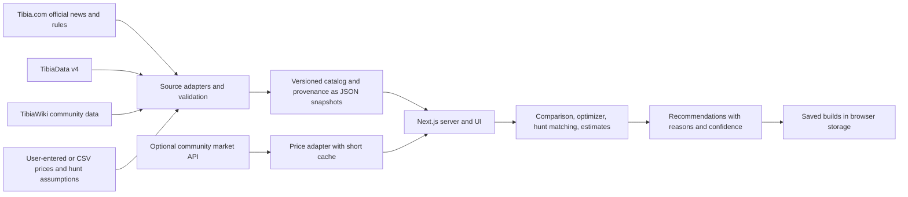

# Architecture proposal

**Status:** Phase 00 proposal; implementation requires approval  
**Reviewed:** 2026-10-12; revised 2026-10-13 after source verification (see `data-sources.md`)

## Product scope

The product is a web app for official Tibia. It supports Knight, Paladin, Sorcerer, Druid, and Monk; compares items; builds and optimizes full equipment sets under a budget; matches hunts; estimates hunt outcomes; saves builds; and explains prices, upgrades, ROI, and data confidence.

The research found that no single source supplies the catalog, item mechanics, hunt recommendations, character equipment, and current market prices. The app therefore needs a source-aware data layer, visible gaps, and explicit user inputs. It must not fill unknown data with guessed mechanics or prices.

## Positioning

Free tools already cover parts of this scope: [TibiaBuddy](https://www.tibiabuddy.com/tools/equipment) (best gear by vocation and level, including Monk; offline on 2026-10-13 with its Vercel deployment disabled), [TibiaPal](https://tibiapal.com/equipment) (equipment reference by level), [TibiaCalculator](https://tibiacalculator.com/) (equipment/protection calculator), and [OptimizeTibia](https://optimizetibia.com/) (character import and saved builds). None of those reviewed on 2026-10-13 combined world-specific market prices, a budget, and upgrade ROI. That combination is this product's differentiator and should drive phase priority. This is based on each tool's public description, not hands-on testing.

## Recommended stack

| Area | Recommendation | Reason |
| --- | --- | --- |
| Web app | Next.js App Router, React, TypeScript | One codebase for the interactive UI and server-side data access. |
| Catalog storage | Versioned JSON snapshot files in the repository; add PostgreSQL only when accounts, shared builds, or the app's own price history are needed | The equipment catalog changes mainly at the twice-yearly game updates and is a few thousand items. Git history gives snapshots, review diffs, and rollback with no database to host. *(Revised 2026-10-13; originally PostgreSQL from day one.)* |
| Data ingestion | A TypeScript import command in the same repository, run by an operator after game updates or on a schedule | Keeps source parsing and validation separate from page requests without creating a second service. A failed import leaves the committed snapshot in place. |
| Prices | Fetched server-side from the price adapter and cached briefly; user/CSV prices stored with saved builds | Prices change daily, so they do not belong in the catalog snapshot. |
| Optimization | Deterministic TypeScript domain functions | Makes recommendations explainable and reproducible from the same input snapshot. |
| Initial build saving | Browser storage with JSON export/import | Supports saved builds without requiring accounts in the first release. Cross-device sync can be added only if wanted. |
| Hosting | Decide after Phase 01 review | No existing repository or hosting account was found in this task workspace. |

Start as a modular monolith: one app, one catalog snapshot, and one ingestion entry point. Do not add Redis, a separate optimization service, or a microservice split unless real traffic or measured compute time calls for it.

## System shape

The UI reads normalized snapshots, not live third-party pages. Source updates run on a schedule or by an operator, are validated before replacing current values, and keep prior snapshots for comparison and rollback. A failed or blocked source update must not erase the last known-good catalog.

## Data and domain rules

- Give every supported vocation a stable identifier, including Monk. Keep vocation-specific restrictions and mechanics as source-backed fields, not scattered UI conditionals.
- Represent item attributes as typed values, plus slot compatibility, requirements, two-handed/exclusive constraints, and any other verified equipment rules. Preserve the source page and the game revision/date that supports each value.
- Use the client item ID (wiki `itemid`) as the primary item key; it is also the price API's key.
- Model an equipped slot as **base item + forge tier + imbuements**, and for weapons also **+ Weapon Proficiency perks**. Catalog facts (classification, imbuement slot count, perk tree) come from sources; the tier, chosen imbuements, and proficiency progress are per-character user inputs. Comparing bare base items alone gives wrong answers at mid and high level.
- Associate each imported field with its source, source URL/page revision when available, retrieved or observed time, license label, validation status, and confidence. Display stale, disputed, user-provided, and unknown values differently.
- Store market quotes separately from item facts. A quote includes world, item, amount, quote type, source, and observation time. Never present a user-entered asking price as a verified sale price.
- Store game mechanics by effective game revision. Official balance changes can affect an optimizer or estimate; a saved build should retain the data revision used to generate it.
- Keep UI-language choices and deployment provider open until Phase 01. Item names may follow Tibia's source language initially; do not translate names in a way that breaks source matching.

## Optimizer and recommendation behavior

The optimizer should apply hard constraints first (vocation, level, slot, equipment conflicts, and budget), then score only source-backed attributes against the user's goal. Goals may include elemental protection, damage type, healing/sustain, or a user-set mix. Show why each item/set was selected, the price assumptions, and the best alternatives just below the budget. Keep a Pareto-style shortlist when one build cannot dominate on both offense and defense. Do not choose hidden universal weights in Phase 04.

Hunt matching can combine documented hunt information with creature strengths/weaknesses and the user's intended party, level, budget, and risk profile. TibiaWiki-sourced hunt pages currently lack Monk recommendations, so Monk results must be labelled “no source recommendation” or filtered using user-provided assumptions; never copy Knight or Mage recommendations into Monk.

The hunt simulator is a staged estimate, not a promise of exact in-game results. Begin with inputs and calculations that have a verifiable source or are entered by the user. Show assumptions, patch/date, and confidence next to XP, damage, survival, and profit outputs. Do not publish a precise damage, healing, or XP formula until it has been checked against current official documentation or validated observations. Keep unsupported mechanics out of the score rather than silently assigning a value.

## Pricing and ROI

There is no market-price endpoint in the published TibiaData v4 specification and no official price feed. A community API (Tibia Market) provides per-world prices keyed by item ID, but it is collected by automating the game client and has no published terms, so it may only be an optional, labelled source behind an adapter (see `data-sources.md`, finding 4). Phase 07 should start with manual prices and CSV import as the baseline. Keep quotes world-specific and dated. ROI must state which price snapshot and user-entered baseline it uses; it should be a comparison tool, not a claim that an upgrade guarantees a particular profit.

## Phase gates

Phase 01 can create the app shell and data contracts using clearly marked fixtures, without presenting fixtures as live or verified Tibia data. Phase 02 should only connect sources after the attribution, reuse, and API behavior recorded in `data-sources.md` are reviewed. Later phases remain in the agreed order; completing one phase does not automatically start the next.
